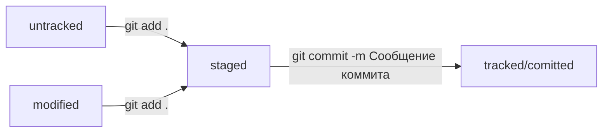

# Шпаргалка по Git 🚀

# Кратко о Git и GitHub

## 🐙 Git
**Что это?** Система контроля версий (VCS) — инструмент для отслеживания изменений в коде.

**Основная идея:** 
- Сохраняет историю всех изменений в вашем проекте
- Позволяет возвращаться к предыдущим версиям
- Помогает работать в команде без конфликтов

**Ключевые особенности:**
- Локальная работа (все хранится на вашем компьютере)
- Ветвление (создание изолированных версий проекта)
- Слияние изменений

---

## 🌟 GitHub
**Что это?** Веб-сервис для хостинга Git-репозиториев + социальная сеть для разработчиков.

**Основная идея:**
- Хранит ваш код в облаке
- Предоставляет инструменты для совместной работы
- Служит портфолио для разработчиков

**Ключевые особенности:**
- Удаленное хранение репозиториев
- Pull Requests для код-ревью
- Issues для отслеживания задач
- GitHub Pages для хостинга сайтов


## Настройка
```bash
# Установить глобальные настройки (для всех репозиториев)
git config --global user.name "Ваше Имя"
git config --global user.email "ваш.email@example.com"

# Установить настройки только для текущего репозитория
git config user.email "ваш.email@example.com"

# Проверить текущие настройки
git config --list
```

## Основной рабочий процесс
```bash
# Инициализировать новый репозиторий
git init

# Клонировать существующий репозиторий
git clone <url-репозитория>

# Проверить статус файлов
git status

# Добавить файлы в staging area
git add <файл>      # конкретный файл
git add .          # все новые и измененные файлы
git add -A         # все файлы (включая удаленные)

# Создать коммит
git commit -m "Описание коммита"

# Просмотреть историю коммитов
git log
git log --oneline  # компактный вид
```

## Работа с ветками
```bash
# Показать список веток
git branch

# Создать новую ветку
git branch <имя-ветки>

# Переключиться на ветку
git checkout <имя-ветки>
git switch <имя-ветки>      # современная альтернатива

# Создать и переключиться на новую ветку
git checkout -b <имя-ветки>
git switch -c <имя-ветки>   # современная альтернатива

# Удалить ветку
git branch -d <имя-ветки>
```

## Работа с удаленным репозиторием
```bash
# Добавить удаленный репозиторий
git remote add origin <url-репозитория>

# Отправить изменения на сервер
git push origin <ветка>

# Загрузить изменения с сервера
git pull origin <ветка>

# Просмотреть удаленные репозитории
git remote -v
```

## Полезные команды
```bash
# Просмотреть изменения в файлах
git diff

# Отменить изменения в файле
git checkout -- <файл>

# Временно сохранить изменения
git stash

# Вернуть сохраненные изменения
git stash pop
```

## Пример типичного workflow
```bash
# Начать работу с новой функцией
git checkout -b feature/new-feature

# Работать над изменениями...
git add .
git commit -m "Добавлена новая функциональность"

# Отправить изменения в удаленный репозиторий
git push origin feature/new-feature
```

## Какие данные отображаются при выводе информации о коммите командой git log

### git log 
- Хеш
- Head
- Автор
- Дата
---

### Хеш
**Хеширование** (от англ. hash, «рубить», «крошить», «мешанина») — 
это способ преобразовать набор данных и получить их 
«отпечаток» (англ. fingerprint).

Информация о коммите — это набор данных: когда был сделан коммит, 
содержимое файлов в репозитории на момент коммита и ссылка на 
предыдущий, или родительский (англ. parent), коммит. Git хеширует 
(преобразует) эту информацию с помощью алгоритма SHA-1 (от англ. 
Secure Hash Algorithm — «безопасный алгоритм хеширования») и 
получает для каждого коммита свой уникальный хеш — результат 
хеширования.

### Head
При вызове команды git log вы также могли заметить надпись 
(**HEAD** -> master) после хеша одного из коммитов.

Файл HEAD (англ. «голова», «головной») — один из служебных 
файлов папки .git. Он указывает на коммит, который сделан 
последним (то есть на самый новый).

Внутри HEAD — ссылка на служебный файл: refs/heads/master 
(или refs/heads/main в зависимости от названия ветки). Если 
заглянуть в этот файл, можно увидеть хеш последнего коммита.

Когда вы делаете коммит, Git обновляет refs/heads/master — 
записывает в него хеш последнего коммита. Получается, что 
HEAD тоже обновляется, так как ссылается на refs/heads/master.

### Автор
В логах коммита отображается **имя автора и его электронная почта**.

### Дата
В логах коммита отображается полная **дата коммита и время**.


---

## Статусы коммита untracked/tracked, staged и modified

Одна из ключевых задач Git — отслеживать изменения файлов в 
репозитории. Для этого каждый файл помечается каким-либо статусом. 

**untracked** (англ. «неотслеживаемый»)

Новые файлы в Git-репозитории помечаются как untracked, то есть 
неотслеживаемые. Git «видит», что такой файл существует, но не 
следит за изменениями в нём. У untracked-файла нет предыдущих 
версий, зафиксированных в коммитах или через команду git add.

**staged** (англ. «подготовленный»)

После выполнения команды git add файл попадает в staging area 
(от англ. stage — «сцена», «этап [процесса]» и area — «область»), 
то есть в список файлов, которые войдут в коммит. В этот момент 
файл находится в состоянии staged.

Staging area также называют index (англ. «каталог») или cache 
(англ. «кеш»), а состояние файла staged иногда называют indexed 
или cached. Все три варианта могут встречаться в документации и 
в качестве флагов команд Git.

**tracked** (англ. «отслеживаемый»)

Состояние tracked — это противоположность untracked. Оно довольно 
широкое по смыслу: в него попадают файлы, которые уже были 
зафиксированы с помощью git commit, а также файлы, которые были 
добавлены в staging area командой git add. То есть все файлы, 
в которых Git так или иначе отслеживает изменения.

**modified** (англ. «изменённый»)

Состояние modified значит, что Git сравнил содержимое файла с 
последней сохранённой версией и нашёл отличия. Например, файл 
был закоммичен и после этого изменён.

**Вот что ещё важно учесть:**

Для файлов в состояниях staged и modified обычно не указывается, 
что они также tracked, потому что это состояние подразумевается.
Команда git add добавляет в staging area только текущее 
содержимое файла. Если вы, например, сделаете git add file.txt, 
а затем измените file.txt, то новое содержимое файла не будет 
находиться в staging. Git сообщит об этом с помощью статуса 
modified: файл изменён относительно той версии, которая уже в 
staging. Чтобы добавить в staging последнюю версию, нужно выполнить 
git add file.txt ещё раз.

**Mermaid схема статуса файла в логах**



---

## Оформление сообщений к коммитам

Есть общие рекомендации по тому, как правильно составить сообщение. 
Оно должно быть:
- относительно коротким, чтобы его было легко прочитать;
- информативным.

**Корпоративный стиль оформления**

Во многих компаниях применяется Jira — система для организации 
проектов и задач. У каждой задачи в Jira есть идентификатор из 
нескольких заглавных латинских букв и номера. Например, LGS-239 
значит, что это 239-я задача в проекте LGS (сокращение от англ. 
logistics — «логистика»).

В корпоративном стиле в начале сообщения обычно указывают Jira-ID, 
а после — текст сообщения.

```bash
$ git commit -m "LGS-239: Дополнить список пасхалок новыми числами"
```
**Стандарт Conventional Commits**

Стандарт Conventional Commits (англ. «соглашение о коммитах») 
отличается качественной документацией и подробной проработкой. 
Он подходит для репозиториев с исходным кодом программ. 
А вот использовать его для других типов проектов было бы неудобно.
Conventional Commits предлагает такой формат коммита: 
<type>: <сообщение>. Первая часть type — это тип изменений. 
Таких типов достаточно много. Вот два примера:
feat (сокращение от англ. feature) — для новой функциональности;
fix (от англ. «исправить», «устранить») — для исправленных ошибок.

```bash
git commit -m "feat: добавить подсчёт суммы заказов за неделю"
```
**GitHub-стиль**

GitHub можно использовать не только для хранения файлов проекта, 
но и для ведения списка задач (англ. issue) этого проекта. 
Если коммит «закрывает» или «решает» какую-то задачу, то в его 
сообщении удобно указывать ссылку на неё. Для этого в любом месте 
сообщения нужно указать #<номер задачи>. Например, вот так.
В таком случае GitHub свяжет коммит и задачу.

```bash
$ git commit -m "Исправить #334, добавить график температуры"
```

**Дополнительные рекомендации для написания коммита**

Для сообщений на русском языке часто рекомендуют использовать 
инфинитивы. Например: Добавить тесты для PipkaService, Исправить 
ошибку #123 и так далее.
Для сообщений на английском рекомендуется использовать повелительное 
наклонение (англ. imperative). Например: Use library mega_lib_300, 
Fix exit button и так далее.
Эти рекомендации сложились исторически, и им следуют многие проекты.


