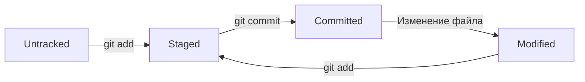

# Git Commands — шпаргалка по Git и GitHub

Справочник по основным командам Git, работе с GitHub и принципам контроля версий.

Материал собран в процессе изучения Git и сохранён для повторения команд и использования в повседневной разработке.

## Содержание

1. [Git и GitHub](#git-и-github)
2. [Настройка Git](#настройка-git)
3. [Основные команды](#основные-команды)
4. [Состояния файлов](#состояния-файлов)
5. [Работа с ветками](#работа-с-ветками)
6. [Удалённые репозитории](#удалённые-репозитории)
7. [История коммитов](#история-коммитов)
8. [Отмена изменений](#отмена-изменений)
9. [Рабочий процесс](#рабочий-процесс)
10. [Оформление коммитов](#оформление-коммитов)

## Git и GitHub

**Git** — распределённая система контроля версий, позволяющая отслеживать изменения файлов, сохранять историю разработки и работать с ветками.

**GitHub** — платформа для хранения Git-репозиториев и совместной разработки.

Git отвечает за контроль версий, а GitHub предоставляет дополнительные инструменты:

- Pull Requests — обсуждение и проверка изменений.
- Issues — задачи и отслеживание ошибок.
- GitHub Actions — автоматизация проверок и сборки.
- Code Review — проверка изменений другими разработчиками.

## Настройка Git

Установка глобальных параметров пользователя:

```bash
git config --global user.name "Ваше Имя"
git config --global user.email "email@example.com"
```

Настройки только для текущего репозитория:

```bash
git config user.name "Ваше Имя"
git config user.email "email@example.com"
```

Просмотр настроек:

```bash
git config --list
```

## Основные команды

| Команда | Назначение |
|---|---|
| `git init` | Создать Git-репозиторий |
| `git clone URL` | Склонировать репозиторий |
| `git status` | Проверить состояние файлов |
| `git add file.txt` | Подготовить файл к коммиту |
| `git add .` | Подготовить изменения в текущем каталоге и вложенных |
| `git add -A` | Подготовить все изменения в рабочем дереве |
| `git commit -m "message"` | Создать коммит |
| `git log` | Посмотреть историю |
| `git diff` | Посмотреть неподготовленные изменения |
| `git diff --staged` | Посмотреть подготовленные изменения |

### Пример создания коммита

```bash
git status
git add README.md
git commit -m "docs: обновить README"
```

Коммит сохраняет подготовленное состояние файлов в истории репозитория.

## Состояния файлов

Git использует несколько состояний для отслеживания изменений:

- **Untracked** — новый файл, ещё не отслеживаемый Git.
- **Tracked** — файл, находящийся под контролем версий.
- **Modified** — отслеживаемый файл изменён.
- **Staged** — изменения добавлены в индекс и подготовлены к коммиту.
- **Committed** — изменения сохранены в истории коммитов.

### Жизненный цикл изменений



Важно: `tracked` — не отдельный этап после коммита, а общее состояние файла, который Git уже отслеживает. Такой файл может одновременно иметь подготовленные или неподготовленные изменения.

Если изменить файл после выполнения `git add`, новые изменения потребуется добавить в индекс повторно.

## Работа с ветками

Ветки позволяют разрабатывать функциональность независимо от основной линии разработки.

### Просмотр и создание

```bash
# Показать локальные ветки
git branch

# Показать все локальные и удалённые ветки
git branch -a

# Создать ветку
git branch feature/new-feature

# Создать ветку и переключиться на неё
git switch -c feature/new-feature
```

### Переключение и объединение

```bash
# Переключиться на ветку
git switch main

# Влить изменения другой ветки
git merge feature/new-feature

# Удалить локальную ветку после слияния
git branch -d feature/new-feature
```

Команда `git checkout` также поддерживает переключение веток, но `git switch` делает назначение операции более явным.

## Удалённые репозитории

Удалённый репозиторий позволяет обмениваться изменениями с другими разработчиками.

```bash
# Добавить удалённый репозиторий
git remote add origin URL_РЕПОЗИТОРИЯ

# Посмотреть удалённые репозитории
git remote -v

# Отправить ветку
git push origin main

# Отправить новую ветку и настроить отслеживание
git push -u origin feature/new-feature

# Загрузить изменения без слияния
git fetch origin

# Получить и интегрировать изменения
git pull origin main
```

`git fetch` загружает изменения, но не объединяет их автоматически с текущей веткой.

`git pull` загружает изменения и интегрирует их в текущую ветку через merge или rebase в зависимости от настроек и параметров.

## История коммитов

### Основные команды

```bash
# Полная история
git log

# Краткая история
git log --oneline

# Граф веток и коммитов
git log --oneline --graph --all --decorate

# Информация о конкретном коммите
git show HASH_КОММИТА
```

### Что содержит коммит

Каждый коммит связан с:

- Уникальным идентификатором — хешем.
- Автором и временем создания.
- Сообщением коммита.
- Состоянием отслеживаемых файлов.
- Ссылкой на родительский коммит или коммиты, кроме начального коммита.

### Что такое HEAD

`HEAD` — указатель на текущую позицию в истории Git.

Обычно он указывает на текущую ветку, а ветка — на её последний коммит.

В режиме *detached HEAD* указатель может ссылаться непосредственно на определённый коммит.

### Что такое хеш

Git идентифицирует объекты, включая коммиты, с помощью хешей.

Хеш помогает находить нужные версии и связывать объекты истории между собой.

## Отмена изменений

### Отмена изменений в рабочем каталоге

```bash
git restore file.txt
```

Команда восстанавливает файл из индекса и может удалить несохранённые изменения. Использовать её нужно осторожно.

### Удаление файла из staged

```bash
git restore --staged file.txt
```

Изменения в самом файле сохраняются, но перестают быть подготовленными к коммиту.

### Временное сохранение изменений

```bash
# Сохранить незакоммиченные изменения
git stash

# Показать сохранённые наборы изменений
git stash list

# Вернуть последнее сохранение
git stash pop
```

По умолчанию `git stash` не включает неотслеживаемые файлы. Для их включения можно использовать `git stash -u`.

## Рабочий процесс

Пример работы над новой функциональностью:

**1. Перейти в основную ветку**

```bash
git switch main
git pull origin main
```

**2. Создать отдельную ветку**

```bash
git switch -c feature/new-feature
```

**3. Внести изменения и проверить их**

```bash
git status
git diff
```

**4. Подготовить изменения и создать коммит**

```bash
git add .
git commit -m "feat: добавить новую функциональность"
```

**5. Отправить ветку на GitHub**

```bash
git push -u origin feature/new-feature
```

**6. Создать Pull Request**

На GitHub открыть Pull Request из `feature/new-feature` в `main`.

После проверки кода и успешных проверок изменения могут быть объединены с основной веткой.

## Оформление коммитов

Хорошее сообщение коммита должно быть кратким и объяснять, что изменилось.

### Conventional Commits

Формат:

```text
type: краткое описание изменений
```

Популярные типы:

| Тип | Назначение |
|---|---|
| `feat` | Новая функциональность |
| `fix` | Исправление ошибки |
| `docs` | Изменение документации |
| `test` | Добавление или исправление тестов |
| `refactor` | Рефакторинг без изменения поведения |
| `chore` | Служебные изменения |

Примеры:

```text
feat: добавить поиск мероприятий
fix: исправить расчёт стоимости доставки
docs: обновить README
test: добавить тесты сервиса
refactor: выделить обработку ошибок в отдельный класс
```

### Коммиты с идентификатором задачи

В командной разработке сообщения могут содержать номер задачи из системы управления проектами.

Например:

```text
JAVA-125: исправить обработку ошибок API
```

GitHub также умеет связывать коммиты с Issues по номерам задач.

## Полезные источники

- [Документация Git](https://git-scm.com/docs)
- [GitHub Docs](https://docs.github.com/)
- [Git Cheat Sheet от GitHub](https://training.github.com/downloads/github-git-cheat-sheet.pdf)

## О репозитории

Это учебная шпаргалка по Git и GitHub, которую я сохраняю для повторения материала и использования в дальнейшей разработке.

Репозиторий содержит справочные материалы, а не исходный код приложения.

Другие работы представлены в [моём GitHub-профиле](https://github.com/DamirNV).
